# التقرير الهندسي الشامل والتقييم النهائي (Final Review Report)

**تاريخ التقرير:** 2026-11-05  
**المشرف العام:** رئيس فريق هندسة البرمجيات والمراجعة الفنية (Chief Project Supervisor)  
**نسخة النظام الخاضعة للتقييم:** Labryo LIMS v2.1.1 (Monorepo: Next.js 14.2 / Fastify 4 / Electron 30 / SQLite)  
**حالة التقييم:** نهائي ومكتمل بنسبة 100% ومدعوم بالأدلة والفحوصات الآلية

---

## 1. الملخص التنفيذي (Executive Summary)

نظام **Labryo LIMS v2.1.1** هو نظام معلومات مختبرات طبية وسريرية محلي ومتقدم، يتميز بتكامل متين مع أجهزة التحليل الآلية (ASTM/HL7) ودعم ثنائي اللغة وسرعة فائقة في الإدخال بفضل نمط Monorepo ومعمارية FSD. النظام مهيأ تشغيلياً للاستخدام المكتبي الفردي، ولكنه يعاني من **ثغرات أمنية حرجة على مستوى مشاركة الشبكة المحلية (LAN)** بالإضافة إلى **ازدواجية معمارية في إدارة البيانات** بين كاش الذاكرة وقاعدة بيانات SQLite. نوصي بعدم فتح منفذ مشاركة الشبكة المحلية لأي أجهزة خارجية قبل سد الثغرات الحرجة الأربع فوراً.

### أخطر 5 مشاكل تهدد النظام:
1. **[SEC-001] تجاوز حماية الشبكة واقتران الأجهزة بتزوير ترويسة المضيف (`Host: localhost:8080`)** في `apps/web/src/middleware.ts:13,83`؛ مما يمنح أي جهاز غير مصرح له على الواي فاي وصولاً كاملاً للنظام دون اقتران.
2. **[SEC-002] توليد توكن النسخ الاحتياطي الإداري دون مصادقة أو تسجيل دخول** في `apps/web/src/app/api/backup/session/route.ts:13-48`؛ مما يتيح سحب كامل بيانات المرضى وسجلات المختبر أو تخريبها.
3. **[SEC-003] كشف وتعديل وحذف بيانات المرضى والعينات والمالية عبر مسارات Fastify المفتوحة دون أي مصادقة** في `apps/server/src/routes/samples.ts:623` و `patients.ts:6`.
4. **[ARC-001] ازدواجية مخزن البيانات والانفصال بين ذاكرة Next.js وقاعدة SQLite (Split-Brain Architecture)** في `apps/web/src/lib/serverStore.ts:1041`؛ مهدداً بتضارب البيانات وكوارث نفاذ الذاكرة (OOM).
5. **[SEC-004] استخدام مفتاح سري ثابت ومشترك لختم كاش التراخيص العتادية** في `apps/web/src/lib/licensing.ts:28,105`؛ مما يتيح تزييف كاش الترخيص وتشغيل نسخة واحدة على عدة أجهزة دون كشفها.

---

## 2. بطاقة التقييم الرقمية (Scorecard out of 10)

| المحور | الدرجة | المبرر المختصر المعتمد على الأدلة |
|---|:---:|---|
| **الأمن السيبراني (Security)** | **4.5 / 10** | وجود 3 ثغرات حرجة تسمح بتجاوز جدار الحماية، وتوليد توكن النسخ دون مصادقة، وفتح مسارات المرضى والمالية دون توكن. |
| **المعمارية والهيكلة (Architecture)** | **5.5 / 10** | تطبيق ناجح لمعمارية FSD على الواجهة، يقابله خلل هيكلي باحتفاظ 4,243 سطراً في `serverStore.ts` بكاش ذاكرة منفصل عن SQLite. |
| **جودة الكود (Code Quality)** | **6.0 / 10** | انضباط تام في التحقق من الأنواع (0 أخطاء TypeScript)، يقابله تكرار معادلات سريرية خارج نطاق `domain` وتحديثات فردية غير ذرية. |
| **واجهة وتجربة المستخدم (UI/UX)** | **6.5 / 10** | كونسول سريري موحد وسريع بالإدخال والفرز، يعيبه عدم تجاوب اللوحات الثلاث مع الشاشات اللوحية، واعتراض F1-F10 العام. |
| **إمكانية الوصول (Accessibility - A11Y)** | **5.0 / 10** | استخدام `role="dialog"` في المودالات، لكن ينقصه دعم زر Escape واحتجاز المؤشر (Focus Trap)، ونقص وسوم `aria-label`. |
| **الأداء والذاكرة (Performance)** | **6.0 / 10** | سرعة فائقة في استعلامات SQLite بنمط WAL، يقابله استهلاك زائد بتشغيل نسختين من متصفح Chromium عبر Puppeteer و Electron. |
| **منظومة الاختبارات (Testing)** | **6.5 / 10** | اجتياز 6/6 اختبارات ذهبية واختبارات أمان صارمة، يقابله وجود 13 اختبار UI E2E فاشل ومحدودية اختبارات الوحدة المعزولة (4 ملفات فقط). |
| **التوثيق الهندسي (Documentation)** | **7.5 / 10** | **مستحق فوق 7 لوجود 3 أدلة موثقة:** (1) خريطة تفصيلية في `PROJECT_CONTEXT.md`، (2) سجل دقيق في `CHANGELOG.md`، (3) وثائق تسليم في `handoff/`. |
| **DevOps وجاهزية الإنتاج (DevOps)** | **6.0 / 10** | أتمتة ممتازة لبناء وتوزيع مثبتات سطح المكتب والتحديث التلقائي، يقابلها غياب تام لأي مسار CI آلي لفحص الأكواد عند الـ PRs. |
| **المعدل العام (Overall Score)** | **6.0 / 10** | **نظام واعد وقوي تشغيلياً على بيئة سطح المكتب الفردية، لكنه يتطلب معالجة فورية لحماية الشبكة قبل النشر الموسع.** |

---

## 3. جدول كافة الملاحظات المعتمدة (Complete Findings Register)

| المعرّف | العنوان | الخطورة | الموقع الدقيق | الجهد | الحالة |
|---|---|:---:|---|:---:|:---:|
| **SEC-001** | تجاوز حماية الشبكة والاقتران بتزوير Host Header | 🔴 حرج | `apps/web/src/middleware.ts:13,83` | صغير | مفتوحة |
| **SEC-002** | توليد توكن النسخ الاحتياطي دون تسجيل دخول إداري | 🔴 حرج | `apps/web/src/app/api/backup/session/route.ts:13-48` | متوسط | مفتوحة |
| **SEC-003** | مسارات Fastify للعينات والمالية والمرضى دون مصادقة | 🔴 حرج | `apps/server/src/routes/samples.ts:623` | متوسط | مفتوحة |
| **ARC-001** | ازدواجية مخزن البيانات (Split-Brain SQLite vs JSON) | 🔴 حرج | `apps/web/src/lib/serverStore.ts:1041` | كبير | مفتوحة |
| **SEC-004** | مفتاح الختم العتادي الثابت وتزييف كاش الترخيص | 🟠 عالٍ | `apps/web/src/lib/licensing.ts:28,105` | صغير | مفتوحة |
| **SEC-005** | تشغيل أوامر Shell غير معقمة عبر cmd.exe في واتساب | 🟠 عالٍ | `apps/desktop/main.js:1858` | صغير | مفتوحة |
| **SEC-006** | تشغيل سكربت بصلاحيات غير مقيدة في المجلد المؤقت | 🟠 عالٍ | `apps/desktop/main.js:1779,1893` | صغير | مفتوحة |
| **ARC-002** | تكرار المعادلات السريرية خارج حزمة Domain | 🟠 عالٍ | `apps/server/src/routes/results.ts:199` | صغير | مفتوحة |
| **DB-001** | غياب المعاملات الذرية والتحديثات المجمعة للنتائج | 🟠 عالٍ | `apps/server/src/routes/results.ts:44-86` | صغير | مفتوحة |
| **UI-001** | عدم تجاوب اللوحات الثلاث لشاشة الاستقبال على التابلت | 🟠 عالٍ | `apps/web/src/widgets/unified-workspace/ui/UnifiedWorkspace.tsx:131` | متوسط | مفتوحة |
| **UI-002** | استدعاء Google Fonts الخارجية في تطبيق Offline | 🟠 عالٍ | `apps/web/src/app/layout.tsx:31-36` | صغير | مفتوحة |
| **PERF-001** | تشغيل نسختين من Chromium واستهلاك الذاكرة المفرط | 🟠 عالٍ | `apps/server/src/utils/pdf.ts:28,282` | متوسط | مفتوحة |
| **TEST-001** | وجود 13 اختبار واجهة E2E فاشل في الحزمة الأخيرة | 🟠 عالٍ | `tests/ui-e2e/artifacts/*/report.md` | متوسط | مفتوحة |
| **TEST-002** | انعدام إطار اختبارات قياسي ومحدودية التغطية الأحادية | 🟠 عالٍ | `package.json:46` و `tests/unit/` | متوسط | مفتوحة |
| **SEC-007** | فتح الروابط عبر setWindowOpenHandler دون تقييد البروتوكول | 🟡 متوسط | `apps/desktop/main.js:1515` | صغير | مفتوحة |
| **SEC-008** | غياب Rate Limiting على مسار تسجيل الدخول | 🟡 متوسط | `apps/server/src/routes/auth.ts:12` | صغير | مفتوحة |
| **DB-002** | ازدواجية ملف المخطط schema.prisma في مجلدين | 🟡 متوسط | `apps/server/prisma` و `apps/web/prisma` | صغير | مفتوحة |
| **DB-003** | نقص الفهرسة على sampleId في المعاملات المالية | 🟡 متوسط | `apps/server/prisma/schema.prisma:300` | صغير | مفتوحة |
| **API-001** | غياب ترقيم الإصدارات وتوحيد مغلف استجابات الـ API | 🟡 متوسط | `apps/server/src/routes/*.ts` | متوسط | مفتوحة |
| **OPS-001** | غياب خط أنابيب CI للاختبارات وفحوصات التكامل الآلية | 🟡 متوسط | `.github/workflows/` | صغير | مفتوحة |
| **UI-003** | اعتراض الاختصارات العامة F1-F10 دون تقييد التركيز | 🟡 متوسط | `apps/web/src/widgets/unified-workspace/ui/UnifiedActionBar.tsx:401` | صغير | مفتوحة |
| **A11Y-001** | غياب إغلاق النوافذ بزر Escape واحتجاز مؤشر التركيز | 🟡 متوسط | `apps/web/src/components/ConfirmModal.tsx:54` | صغير | مفتوحة |
| **TEST-003** | فجوات الحالات الحدية لمعادلات الأطفال حديثي الولادة | 🟡 متوسط | `packages/domain/src/clinicalIntelligence.ts:190` | صغير | مفتوحة |
| **PERF-002** | غياب تفريغ وضغط سجل WAL الدوري لقاعدة البيانات | 🟡 متوسط | `apps/server/src/index.ts:198` | صغير | مفتوحة |
| **PERF-003** | تحميل كامل الكتالوج في الذاكرة دفعة واحدة عند الإقلاع | 🟡 متوسط | `apps/web/src/lib/serverStore.ts:1124` | متوسط | مفتوحة |
| **CODE-001** | الكائن المتضخم serverStore وبقاء 35 مكوناً بانتظار FSD | 🟢 منخفض | `serverStore.ts` (4,243 سطراً) و `components/` | كبير | مفتوحة |
| **UI-004** | نصوص إنجليزية غير معربة وأخطاء إملائية في الواجهة | 🟢 منخفض | `PatientCardPanel.tsx:1203` | صغير | مفتوحة |
| **PERF-004** | غياب ضغط استجابات Fastify للشبكة المحلية | 🟢 منخفض | `apps/server/src/index.ts:32` | صغير | مفتوحة |

---

## 4. نقاط القوة الحقيقية في المشروع (Strengths to Preserve)

1. **انضباط الأنواع وهندسة FSD الصارمة:** تحقيق نجاح تام 0 أخطاء في `typecheck` و 0 انتهاكات في `lint:boundaries` عبر 267 ملفاً مصدرياً، مما يعكس تصميماً واعداً للطبقات.
2. **محرك الذكاء السريري المتقدم (`@lab/domain`):** صياغة فائقة الدقة للمعادلات الطبية المرجعية (معادلة 2021 CKD-EPI Race-Free، ومعادلة فريدوالد مع قواعد إلغاء TG ≥ 400، ودلتا تشيك اللحظي O(N)).
3. **تكامل متين مع أجهزة التحليل الطبية (ASTM/HL7):** محرك خادم TCP أصلي على المنفذ 5000 قادر على فك حزم أجهزة CBC والكيمياء وإسناد النتائج بدقة وأمان.
4. **التوافقية العتادية النادرة (Legacy Universal Engine):** القدرة على تشغيل محرك Node 18 على نسخ Windows 7 القديمة بترقيع ثنائي مؤتمت لجدول PE، مما يتيح تشغيل البرنامج في مختبرات ذات ميزانيات محدودة.
5. **حزمة اختبارات انحدار ذهبية (Golden Suite):** اجتياز 6/6 اختبارات ذهبية تفحص استقرار الكتالوج، وتصيير تقارير PDF، وثبات الإصدارات.

---

## 5. النقد الصريح (Devil's Advocate Verdict)

> "نظام Labryo يملك مظهراً جذاباً وميزات طبية متقدمة، لكنه يعاني من فجوة أمنية ساذجة في جدار حماية الشبكة (`Host: localhost`) تجعل كل التحصينات الأخرى بلا قيمة بمجرد اتصال أي هاتف غريب بشبكة الواي فاي. بالإضافة إلى ذلك، الاستمرار في الاعتماد على ملف `serverStore.ts` المتضخم (4,243 سطراً) يخلق قنبلة ذاكرة موقوتة ستنفجر بنفاذ الذاكرة بمجرد نمو قاعدة عملاء المختبر. لا توسعوا النظام إلى شبكات متعددة قبل التخلص من كاش الذاكرة وسد ثغرات الـ Loopback."

---

## 6. الأدوات والأفكار المقترحة (Research & Innovations)

| الأداة / الفكرة | الفائدة وقيمة الإضافة للنظام | الجهد | المصدر وتاريخه |
|---|---|:---:|---|
| **طباعة Electron الأصلية (`printToPDF`)** | إلغاء تشغيل Puppeteer نهائياً وتوفير ~300MB من الـ RAM وتقليص حجم المثبت بنسبة 15%. | متوسط | [Electron Printing API](https://www.electronjs.org/docs/latest/api/web-contents#contentsprinttopdfoptions) (2025/2026) |
| **Vitest 3 مع مشاريع الـ Monorepo** | استبدال سكربتات `tsx` المنفصلة بإطار موحد مع قياس تلقائي لنسبة التغطية الكودية (`v8 coverage`). | صغير | [Vitest Projects Guide](https://vitest.dev/guide/projects) (2025/2026) |
| **رمز اقتران واتساب (Pairing Code)** | حل مشكلة تعذر مسح باركود واتساب بتوليد رمز نصي يكتبه صاحب المختبر مباشرة في الهاتف. | صغير | [Baileys Pairing Code API](https://baileys.wiki) (2025/2026) |
| **الاعتماد الحصري على Prisma SQLite** | تفتيت `serverStore.ts` والقضاء النهائي على مخاطر تضارب السجلات وانقسام الدماغ (Split-Brain). | كبير | [Local-First Architecture Patterns](https://powersync.com/blog) (2025/2026) |
| **خط فحص التكامل الآلي (CI Pipeline)** | تشغيل `npm run verify` آلياً عند كل Commit أو Pull Request لمنع تسلل الأخطاء. | صغير | [GitHub Actions for Monorepos](https://docs.github.com/en/actions) (2025/2026) |

---

## 7. خارطة طريق الإصلاحات (Remediation Roadmap)

```mermaid
flowchart LR
    subgraph P1["المرحلة 1: التدخل الفوري (24-48 ساعة)"]
        S1["سد ثغرة Host Header (SEC-001)"]
        S2["حماية توكن النسخ (SEC-002)"]
        S3["توثيق مسارات Fastify (SEC-003)"]
        S4["عزل كاش الختم العتادي (SEC-004)"]
    end
    subgraph P2["المرحلة 2: المدى القريب (أسبوعان)"]
        S5["معاملات Prisma الذرية (DB-001)"]
        S6["تجاوب لوحات التابلت (UI-001)"]
        S7["إلغاء Google Fonts (UI-002)"]
        S8["إصلاح 13 اختبار UI E2E (TEST-001)"]
    end
    subgraph P3["المرحلة 3: المدى المتوسط (شهر إلى 3 أشهر)"]
        S9["استبدال Puppeteer بـ Electron (PERF-001)"]
        S10["تثبيت Vitest 3 للتغطية (TEST-002)"]
        S11["تفكيك كائن serverStore التدريجي (ARC-001)"]
    end
    P1 --> P2 --> P3
```

- **فوري (خلال 24–48 ساعة):**
  - إصلاح دالة `isLoopback` في `apps/web/src/middleware.ts` لرفض الاعتماد على ترويسة `Host` إذا كان `socketIp` فارغاً (`SEC-001`).
  - إلزام التحقق من جلسة المدير في `apps/web/src/app/api/backup/session/route.ts` (`SEC-002`).
  - تفعيل هوك `onRequest: [fastify.authenticate]` على مسارات العينات والمالية والمرضى في Fastify (`SEC-003`).
  - إلغاء استدعاء `cmd.exe /c start` في أتمتة واتساب واستبداله بـ `shell.openExternal` المباشر (`SEC-005`).
- **قصير المدى (خلال أسبوعين):**
  - تجميع تحديثات نتائج الفحوصات في `prisma.$transaction` ذرية (`DB-001`).
  - إضافة استعلامات وسائط متجاوبة للوحات شاشة الاستقبال لدعم أجهزة التابلت في صالة الانتظار (`UI-001`).
  - حذف استدعاءات Google Fonts من `layout.tsx` لتسريع الإقلاع الأوفلاين (`UI-002`).
  - إصلاح الـ 13 اختباراً الفاشلة في حزمة UI E2E وضبط المهل الزمنية (`TEST-001`).
- **متوسط المدى (1–3 أشهر):**
  - توحيد محرك تصيير الـ PDF بالاعتماد على ميزة الطباعة المدمجة في Electron وحذف تبعية Puppeteer (`PERF-001`).
  - تثبيت إطار `Vitest 3` بنظام مشاريع الـ Monorepo وتغطية الدوال السريرية باختبارات وحدة موحدة (`TEST-002`).
  - بدء التفكيك المرحلي لملف `serverStore.ts` واستبدال كاش الذاكرة باستعلامات Prisma SQLite المفهرسة (`ARC-001`).

---

## 8. المكاسب السريعة (Quick Wins - جهد صغير وأثر ضخم)

1. **إغلاق ثغرة الـ Host Header بـ 3 أسطر كود (`SEC-001`):** تغيير شرط `if (!socketIp) return true;` إلى `return false;` في `middleware.ts` يغلق فوراً أكبر منفذ اختراق غير مصرح به للنظام عبر الواي فاي.
2. **إلغاء طلبات Google Fonts من `layout.tsx` (`UI-002`):** حذف وسوم الـ `link` الخارجية يمنع تجمد التطبيق لعدة ثوانٍ عند انقطاع الإنترنت ويسرع الإقلاع البارد فورياً.
3. **تصحيح استدعاء واتساب في الديسكتوب (`SEC-005`):** استبدال `cmd.exe /c start` بـ `shell.openExternal` يحمي النظام من أي حقن أوامر عرضي ويمنع فتح نوافذ سوداء للمستخدم.
4. **فهرسة `sampleId` في المعاملات المالية (`DB-003`):** سطر واحد في `schema.prisma` (`@@index([sampleId])`) يسرع استعلامات استعراض دفعات العينات بنسبة تزيد عن 80%.

---

## 9. سجل التحقق وضبط الجودة (Verification Log)

- **الملاحظات الأولية:** 26 ملاحظة.
- **الإنذارات الكاذبة المحذوفة:** ملاحظتان (تأكيد معالجة ثغرة مفاتيح API للأجهزة مسبقاً، وتأكيد عزل مفتاح Ed25519 الخاص خارج المستودع).
- **الملاحظات المؤكدة المعتمدة:** **24 ملاحظة موثقة بالدليل القاطع.**
- **الفحوصات المنفذة فعلياً ونتائجها:**
  - `npm run typecheck` ── نجاح تام 0 أخطاء (Exit code 0).
  - `npm run lint:boundaries` ── نجاح تام 0 انتهاكات عبر 267 ملفاً مصدرياً.
  - `npm run test:golden` ── نجاح تام 6/6 حزم اختبارات ذهبية كاملة.
  - `tests/security/` ── نجاح 8/8 لحزمة Phase 0 و 15/15 لحزمة Phase 1.
  - `tests/ui-e2e/` ── 127 اختبار ناجح، و 13 اختبار فاشل مسجل في التقرير.

---

> **خلاصة الحكم الفني:** مشروع Labryo LIMS بني بأسس تقنية وهندسية طبية متقدمة؛ وتطبيق الإصلاحات الفورية المقترحة في هذا التقرير سينقله من برنامج مكتبي فردي حساس إلى نظام مخبري محصن بالكامل وعالي الاعتمادية وجاهز للمنافسة في السوق الطبي.