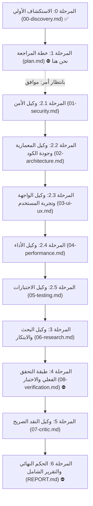

# مرحلة 1: خطة المراجعة والتقييم الشاملة (Review Execution Plan)

**تاريخ الخطة:** 2026-11-05  
**المشرف العام:** رئيس فريق هندسة البرمجيات والمراجعة الفنية (Chief Project Supervisor)  
**حالة الخطة:** جاهزة للاعتماد (نقطة توقف إجبارية ⛔)

---

## 1. تحديد نطاق الفحص وتخصيص الوكلاء (Agent Activation & Scope)

استناداً إلى نتائج الاستكشاف الأولي في المرحلة 0 (نظام إدارة مختبرات طبية وسريرية Labryo LIMS v2.1.1 مبني بنمط Monorepo يدمج Next.js 14 و Electron 30 و Fastify 4 و Prisma SQLite)، تم تفعيل الوكلاء المتخصصين وضبط نطاقات عملهم على النحو التالي:

| الوكيل المتخصص | الحالة | النطاق والمحاور المستهدفة في الكود | الملف المخصص | المعرفات |
|---|---|---|---|---|
| **1. وكيل الأمن (Security)** | **مفعّل** | فحص OWASP Top 10 و API Security، تدقيق أمان تراخيص Ed25519 والختم العتادي HWID، حماية النسخ الاحتياطي عبر Loopback و HMAC، أمان اتصالات الشبكة المحلية LAN، أمان عملية ترقيع واستخراج السكربتات (%TEMP%)، تسرب الأسرار وبيانات المرضى (PHI) في السجلات والذاكرة المؤقتة. | `.review/01-security.md` | `SEC-xxx` |
| **2. وكيل المعمارية وجودة الكود (Architecture & Code)** | **مفعّل** | فحص الالتزام الصارم بمعمارية FSD وفصل الطبقات، مراجعة مسارات Fastify (19 مساراً) ومسارات Next.js (21 صفحة + 21 مسار API)، فحص سلامة استعلامات Prisma SQLite ومؤشرات الأداء N+1، خلو الحسابات السريرية الطبية في `packages/domain` من التكرار والتعقيد الحسابي، ومراجعة جودة الأكواد وفق مبادئ SOLID و Clean Code. | `.review/02-architecture.md` | `ARC-xxx` `CODE-xxx` `DB-xxx` `API-xxx` `OPS-xxx` |
| **3. وكيل واجهة وتجربة المستخدم (UI/UX)** | **مفعّل** | فحص تكامل وسلاسة الكونسول السريري الموحد (Unified Workspace)، سرعة إدخال التحاليل السريرية عبر لوحة المفاتيح (Shift Navigation و Shortcuts)، دقة دعم اللغة العربية والـ RTL، اتساق التباين والألوان الداكنة الطبية، استجابة وتجاوب الشاشات ونوافذ الفحوصات التخصصية الـ 10، وتوافق إمكانية الوصول (WCAG 2.2). | `.review/03-ui-ux.md` | `UI-xxx` `A11Y-xxx` |
| **4. وكيل الأداء (Performance)** | **مفعّل** | فحص أداء إقلاع التطبيق البارد والمستمر (Cold & Warm Startup) واستهلاك الذاكرة في Electron ومحرك Standalone، كفاءة استعلامات SQLite في نمط WAL مع حجم بيانات ضخم، زمن تسخين وتصيير محرك الطباعة بـ Puppeteer، وأداء Core Web Vitals في واجهة الاستقبال والنتائج. | `.review/04-performance.md` | `PERF-xxx` |
| **5. وكيل الاختبارات (Testing)** | **مفعّل** | تحليل تغطية الاختبارات الحالية (170 اختبار E2E عبر Tiers 1-5، واختبارات القبول الـ 9، وحزم الأمان والنسخ الذهبية)، تقييم موثوقية الاختبارات السريرية، كشف الفجوات في الحالات الحدية (Edge Cases) لحسابات التحاليل والأجهزة الطبية، ومراجعة اختبارات ASTM. | `.review/05-testing.md` | `TEST-xxx` |
| **6. وكيل البحث والابتكار (Research)** | **مفعّل** | إجراء بحث حي بالإنترنت لأحدث المعايير والمكتبات الطبية والتقنية (2025–2026): حلول بديلة خفيفة للطباعة بدون Puppeteer، تحديثات حزم الأمان لـ Electron 30 و Fastify 4، وأفضل الممارسات لمزامنة البيانات في الأنظمة غير المتصلة (Local-First Synchronization). | `.review/06-research.md` | `IDEA-xxx` |
| **7. طبقة التحقق والاختبار الفعلي (Verification)** | **مفعّل** | إعادة فحص كل ملاحظة وربطها بالدليل القاطع (`الملف:السطر` مع مقتطف الكود)، تشغيل فحوصات البناء والأنواع والحدود فعلياً، استبعاد الإنذارات الكاذبة بدقة بالغة. | `.review/08-verification.md` | تحقق شامل |
| **8. وكيل النقد الصريح (Devil's Advocate)** | **مفعّل** | نقد شرس للمشروع من زاوية طبيب مختبر دقيق، ومخترق شبكات داخلية، ومستثمر متشكك، وتحديد نقاط الفشل الكارثية لو تضاعف الحمل 10 أضعاف في مختبر مركزي. | `.review/07-critic.md` | `CRIT-xxx` |
| **9. المشرف العام (Final Report)** | **مفعّل** | صياغة الحكم النهائي الشامل، بطاقة التقييم الرقمية لجميع المحاور من 10، خارطة الطريق الزمنية للإصلاحات، وتحديد المكاسب السريعة (Quick Wins). | `.review/REPORT.md` | تقييم نهائي |

---

## 2. النطاقات والوكلاء المُستبعدون مع التعليل (Excluded Scopes)

- **وكيل الحوسبة السحابية و Kubernetes / Terraform:** مُستبعد تماماً، لأن النظام مبني بطبيعته كبرنامج طبي محلي (On-Premise / Offline-First Desktop & Local LAN) مخصص للمختبرات والمستشفيات الخاصة دون اعتمادية على خوادم سحابية خارجية لضمان خصوصية بيانات المرضى وسرية التحاليل واستمرارية العمل في حال انقطاع الإنترنت.
- **وكيل تطبيقات الجوال الأصلية (Native Mobile iOS/Android):** مُستبعد، حيث يتم الوصول عبر التابلت وشاشات العرض من خلال متصفح الويب المحلي عبر الـ LAN وليس عبر تطبيقات أصلية منفصلة.

---

## 3. تسلسل ومراحل التنفيذ (Execution Roadmap)

---

## 4. القواعد الذهبية وضوابط التنفيذ الصارمة
1. **وضع القراءة فقط:** ممنوع تعديل أو حذف أي ملف مصدري في المشروع؛ التعديلات مسموحة فقط في مجلد `.review/`.
2. **إلزامية الدليل القاطع:** كل ملاحظة تذكر وجوباً مسار الملف الدقيق، رقم السطر، ومقتطفاً حقيقياً من الكود. أي ملاحظة بلا دليل تُشطب فوراً.
3. **التوثيق المتسلسل المستقل:** حفظ مخرجات كل وكيل داخل ملفه المخصص، وتقديم ملخص من 3 أسطر فقط في المحادثة لتجنب استهلاك مساحة السياق.
4. **نقطة التوقف الحالية:** التوقف الآن بانتظار أمر اعتماد الخطة من قبلك (`موافق`).